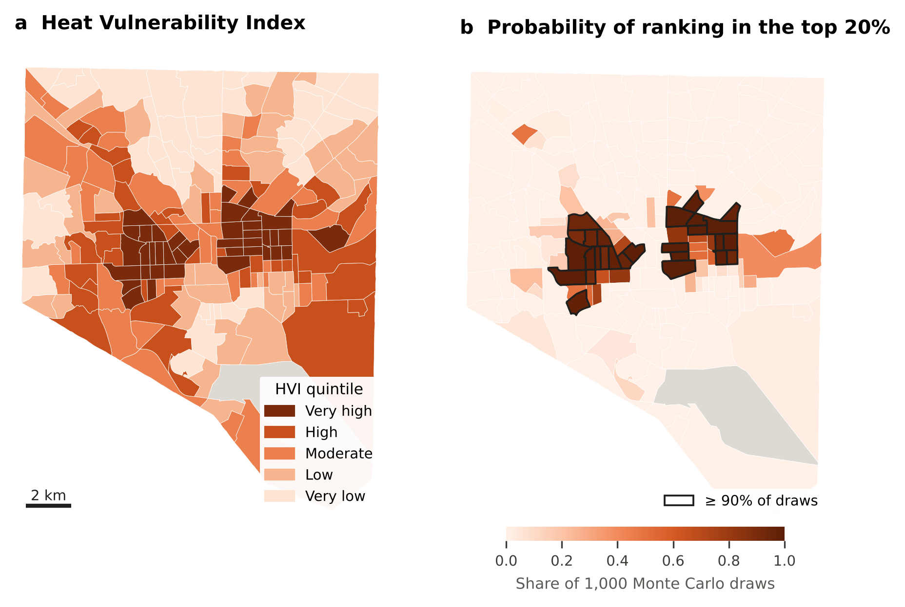
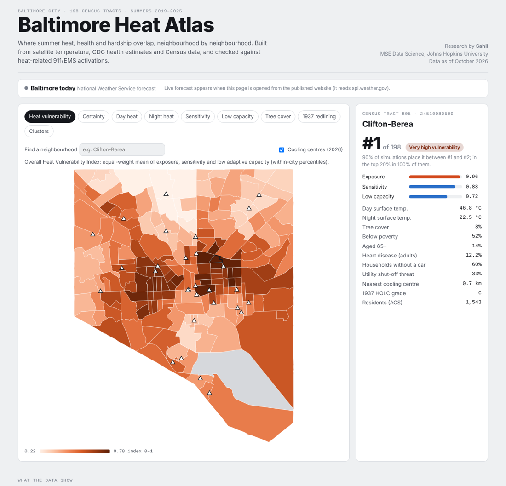
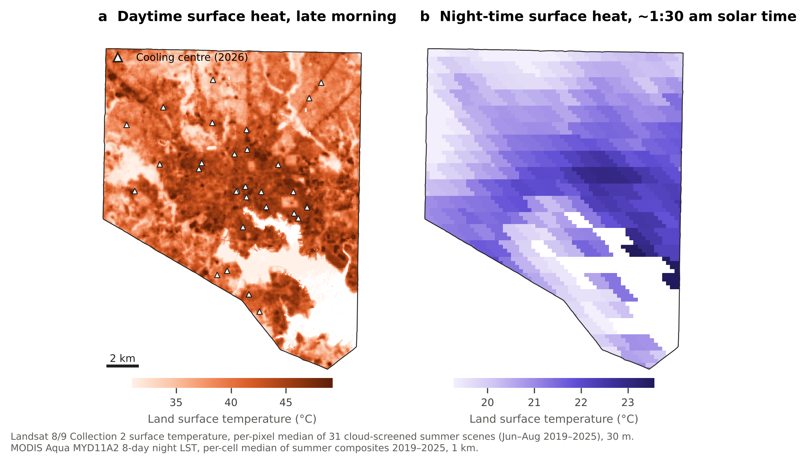
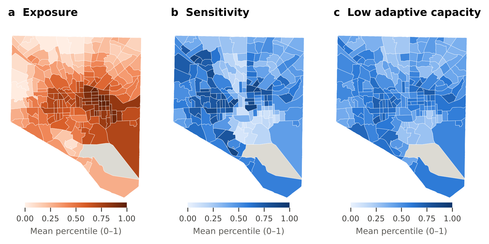
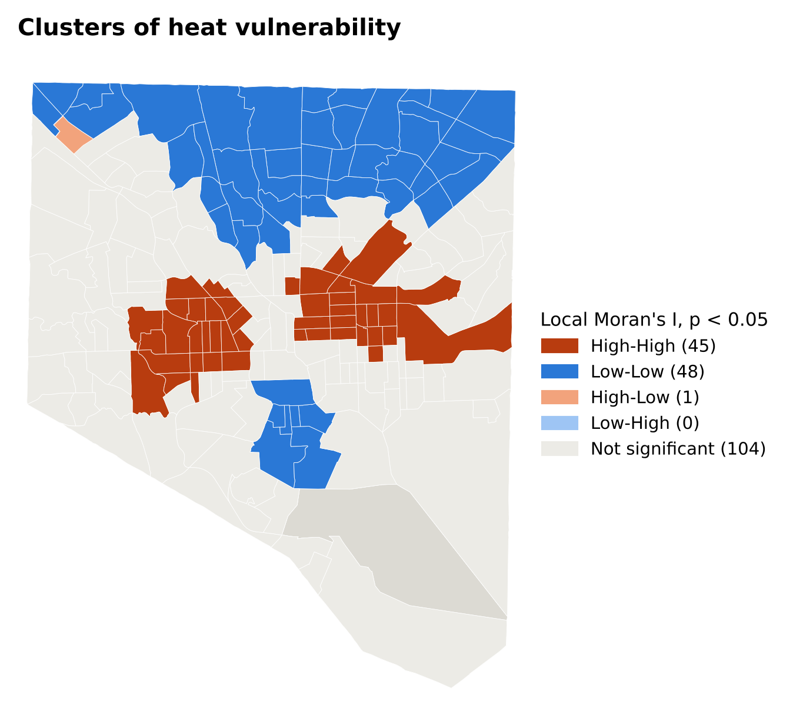
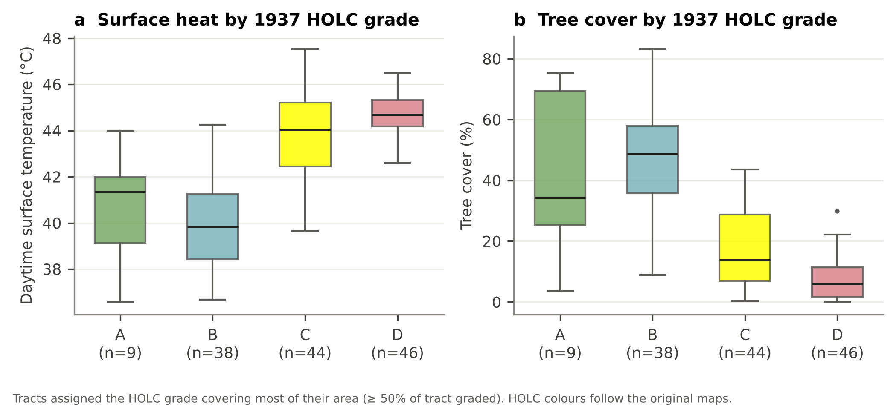
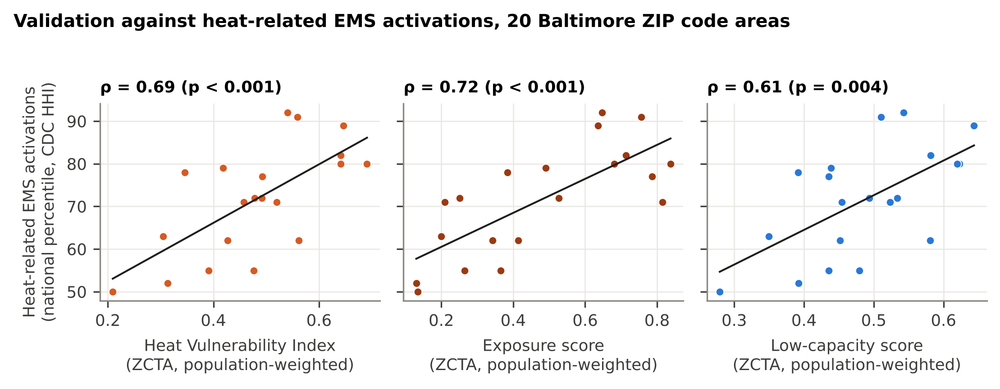
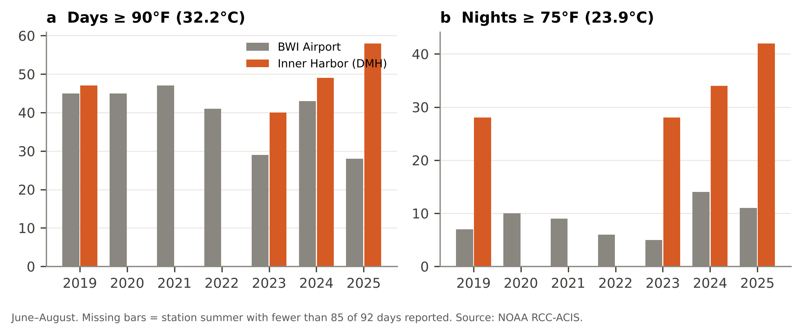

<div align="center">

# Baltimore Heat Atlas

### Where heat meets vulnerability: a validated, uncertainty-aware heat vulnerability index for Baltimore City's census tracts

[](https://sahiljangra12.github.io/baltimore-heat-atlas/)
[](paper/Baltimore_Heat_Vulnerability_Sahil_2026.pdf)
[](data/processed/baltimore_heat_tracts.csv)


**Sahil** · MSE in Data Science, Johns Hopkins University · October 2026

</div>

---

<p align="center">
  
</p>

Extreme heat kills more Americans than any other weather hazard, and within a city its burden is uneven. This project ranks **198 Baltimore City census tracts** by heat vulnerability. It combines:

- **Exposure:** seven summers of Landsat surface temperature, weighted by where people live, plus MODIS night-time heat.
- **Sensitivity:** age, disability and chronic disease (CDC PLACES 2025).
- **Low adaptive capacity:** poverty, isolation, mobility, utility shut-off risk, housing age, cooling-centre access and tree cover.

The index is then tested against **heat-related EMS activations**, an outcome that was not used to build it.

## Key findings

| | Finding |
|---|---|
| 🌡️ **35.7–47.5 °C** | Range of average summer surface temperature where people live, across tracts |
| 🌳 **ρ = −0.88** | Tree cover vs. surface heat: each +10 points of canopy goes with ~0.9 °C cooler ground |
| 🗺️ **+4.4 °C** | Tracts redlined (HOLC grade D) in 1937 are hotter today than grade A/B tracts |
| 📍 **Moran's I = 0.71** | Vulnerability is clustered; 45 tracts form hot spots in East and West Baltimore |
| 🎲 **ρ = 0.97** | Rank stability across 1,000 Monte Carlo draws of data error and index weights |
| 🚑 **ρ = 0.69** | The index tracks heat-related EMS activations across 20 ZIP areas (95% CI 0.35–0.89); the CDC SVI does not (ρ = 0.27) |

In Baltimore, daytime heat exposure is **not** associated with a tract's racial composition (ρ = 0.03), but it is associated with poverty. Vulnerability is strongly associated with both. The racial gap in heat risk works mainly through health and adaptive capacity.

## Interactive dashboard

<p align="center">
  <a href="https://sahiljangra12.github.io/baltimore-heat-atlas/"></a>
</p>

The dashboard has nine map layers: vulnerability, certainty, day and night heat, sensitivity, low capacity, tree cover, 1937 redlining and clusters. You can also look up any tract or neighbourhood, see the validation charts, and read a live National Weather Service forecast with heat alerts. It is a single self-contained file: [`docs/index.html`](docs/index.html).

## Figures

| | |
|---|---|
|  |  |
| **Day and night surface heat** | **Exposure, sensitivity, low capacity** |
|  |  |
| **Vulnerability clusters (LISA)** | **1937 HOLC grade vs. heat and trees** |
|  |  |
| **Validation against EMS activations** | **Hot nights: Inner Harbor vs. BWI** |

## Method in brief

```
Exposure (2)            Sensitivity (9)              Low adaptive capacity (10)
├─ Landsat day LST      ├─ age 65+, under 5          ├─ poverty, no vehicle
│  (31 scenes, 30 m,    ├─ any disability            ├─ 65+ living alone, limited English
│   pop-weighted)       ├─ heart disease, COPD,      ├─ uninsured, no internet
└─ MODIS night LST      │  asthma, diabetes, stroke  ├─ utility shut-off threat
   (01:30, 1 km)        └─ frequent mental distress  ├─ pre-1940 housing
                                                     └─ cooling-centre distance, no trees
        │                         │                              │
        └──── within-city percentile ranks → component means → HVI = mean of 3 ────┘
                                         │
      1,000 Monte Carlo draws (ACS MOE, PLACES CI, inter-annual LST, Dirichlet weights)
                                         │
         validation vs. NEMSIS heat-related EMS activations (CDC HHI, 2020–2022)
```

Full details are in the [paper](paper/Baltimore_Heat_Vulnerability_Sahil_2026.pdf).

## Repository structure

```
baltimore-heat-atlas/
├── src/                     analysis pipeline (run in order)
│   ├── 01_landsat.py            Landsat LST + NDVI composites, cloud screening
│   ├── 02_social_health.py      ACS 2020–24 (with MOE), CDC PLACES 2025, SVI 2022
│   ├── 03_environment.py        exposure, MODIS night LST, tree cover, cooling centres, HOLC
│   ├── 04_analysis.py           index, uncertainty, spatial stats, equity, validation
│   ├── 05_figures.py            publication figures
│   ├── 06_tex_tables.py         LaTeX macros + tables written from results.json
│   └── 07_dashboard_data.py     dashboard data
├── data/processed/          final tract dataset, results.json, validation table
├── outputs/figures/         figures (PDF + PNG, 300 dpi)
├── paper/                   LaTeX source + compiled PDF
├── dashboard/               dashboard template + build script
└── docs/                    GitHub Pages site (the live dashboard)
```

## Reproduce

```bash
pip install -r requirements.txt
# put the raw inputs in data/raw/ (see data/raw/README.md), then:
cd src
python 01_landsat.py && python 02_social_health.py && python 03_environment.py
python 04_analysis.py && python 05_figures.py && python 06_tex_tables.py
python 07_dashboard_data.py && python ../dashboard/build.py
bash ../paper/build.sh       # rebuilds the PDF
```

Every number quoted in the paper is generated automatically from `data/processed/results.json`, so the text cannot drift from the analysis.

## Data sources

| Domain | Source |
|---|---|
| Day heat | USGS Landsat 8/9 Collection 2 Level-2 surface temperature, via Microsoft Planetary Computer |
| Night heat | NASA MODIS MYD11A2 / MOD11A2 v061 |
| Land cover | ESA WorldCover 2021 v200 |
| Health | CDC PLACES, census tract, 2025 release |
| Social | U.S. Census Bureau ACS 5-year 2020–2024; CDC/ATSDR SVI 2022 |
| Outcome | CDC/ATSDR Heat & Health Index 2024 (NEMSIS heat-related EMS activations, 2020–2022) |
| History | Mapping Inequality, University of Richmond (CC BY-NC) |
| Services | Baltimore City Health Department cooling centres, 2026 |
| Geography | Census TIGERweb 2020; BNIA Community Statistical Areas |
| Climate | NOAA RCC-ACIS daily data, BWI and Inner Harbor |

## Citation

```bibtex
@misc{sahil2026baltimoreheat,
  author = {Sahil},
  title  = {Where Heat Meets Vulnerability: A Validated, Uncertainty-Aware Heat Vulnerability Index for Baltimore City's Census Tracts},
  year   = {2026},
  institution = {Johns Hopkins University},
  url    = {https://github.com/sahiljangra12/baltimore-heat-atlas}
}
```

## License

Code is released under the [MIT License](LICENSE). Derived data are shared under CC BY 4.0, except the HOLC-derived fields, which follow Mapping Inequality's CC BY-NC licence. Source datasets keep their original terms.

---

<sub>Satellite land surface temperature measures roofs and pavement, not air temperature. Health values are model-based estimates. The atlas describes neighbourhoods, not individuals. In a heat emergency call 911; for Baltimore cooling-centre information call 311.</sub>
